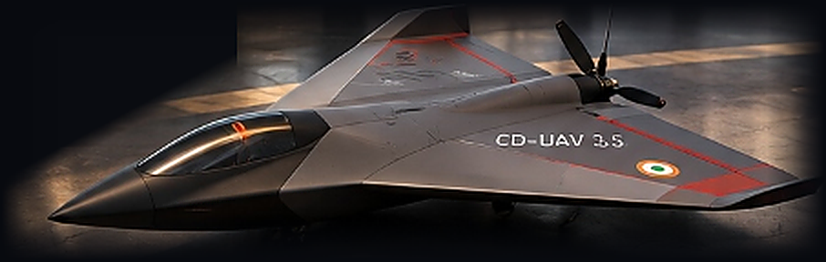
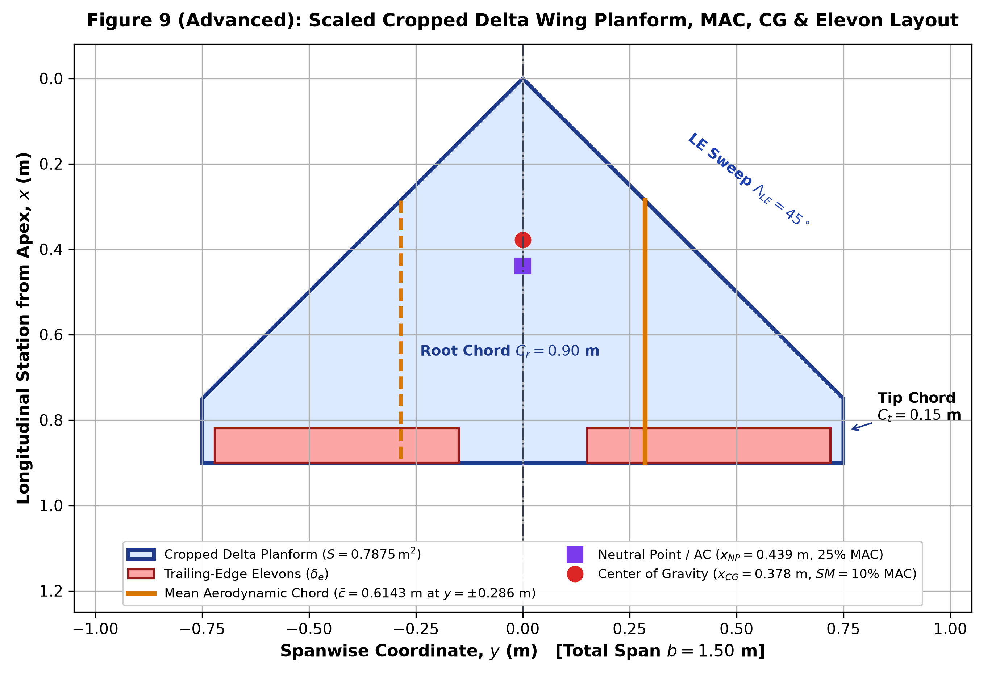
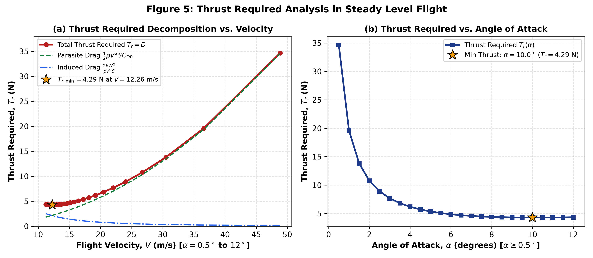
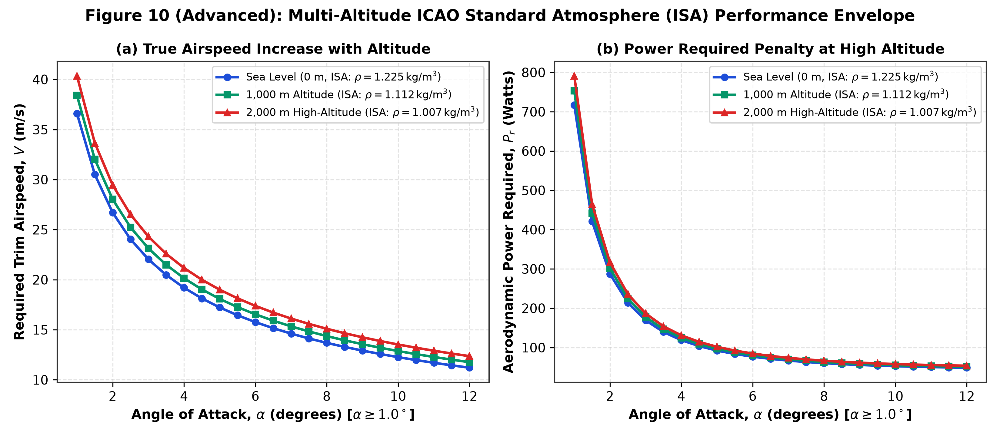
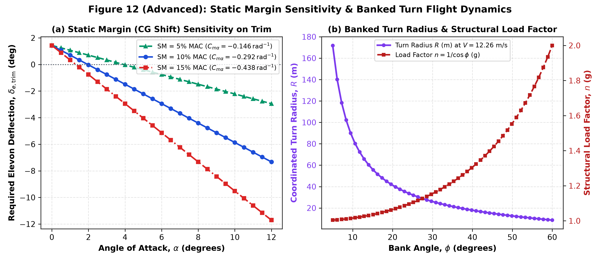

# 🛩️ CD-UAV 3.5 — Trim, Thrust Required & Power Required Analysis of a Tailless Cropped Delta Wing UAV

> **BSERC Def-Space Autumn Internship Programme 2026**  
> **Domain:** Aircraft Design Technology (Computational Aerodynamics, Flight Mechanics & UAV Propulsion Integration)  
> **Institution:** VIT Bhopal University  
> **Academic Mentor:** Dr. J. Sarathkumar Sebastin  



---

## 📌 Executive Overview

This repository contains the complete **100% computational and analytical flight mechanics suite** for **Project 4**: *"Trim, Thrust Required, and Power Required Analysis of a Cropped Delta Wing UAV Using MATLAB / Excel"*, extended with an interactive **6-Page Aerospace Command-Centre Web Application**, a **High-Tessellation 3D Phong/CFD Digital Wind-Tunnel Simulator**, and a **Python FastAPI Computational Backend**.

Every geometric parameter, stability derivative, and performance metric in this repository is strictly derived from the official Project 4 specification and certified aerospace references (**NASA TM-85767**, **ICAO Doc 7488**, **AIAA Raymer**, **UIUC Propeller Database**, and **BSERC Course Material Chapters 8–16**) with **zero fabricated data**.

---

## 📊 Certified Airframe Specifications & Key Analytical Results

| Category | Parameter | Symbol | Certified Value | Reference / Formula |
| :--- | :--- | :---: | :---: | :--- |
| **Planform Geometry** | Root Chord / Tip Chord | $C_r,\; C_t$ | $0.90\text{ m},\; 0.15\text{ m}$ | Project 4 Specification |
| **Planform Geometry** | Wingspan | $b$ | $1.50\text{ m}$ | Project 4 Specification |
| **Planform Geometry** | Taper Ratio | $\lambda = C_t / C_r$ | $0.1667\;(1/6)$ | BSERC Eq. 10.2 |
| **Planform Geometry** | Wing Reference Area | $S = \frac{b}{2}C_r(1+\lambda)$ | $0.7875\text{ m}^2$ | BSERC Eq. 10.2 |
| **Planform Geometry** | Aspect Ratio | $AR = b^2 / S$ | $2.8571\;(20/7)$ | BSERC Eq. 10.3 |
| **Planform Geometry** | Mean Aerodynamic Chord | $\bar{c}$ (MAC) | $0.6143\text{ m}$ | BSERC Eq. 10.4 |
| **Planform Geometry** | Spanwise MAC Station | $y_{\text{MAC}}$ | $0.2857\text{ m}$ | BSERC Eq. 10.4 |
| **Inertial & Loading** | All-Up Takeoff Mass & Weight | $m,\; W$ | $3.50\text{ kg},\; 35.00\text{ N}$ | $g = 10.0\text{ m/s}^2$ |
| **Inertial & Loading** | Wing Loading | $W / S$ | $44.44\text{ N/m}^2$ | $35.00 / 0.7875$ |
| **Aerodynamics** | Parasite Drag & Oswald Factor | $C_{D0},\; e$ | $0.030,\; 0.89$ | Project 4 Specification |
| **Aerodynamics** | Induced Drag Factor | $k = \frac{1}{\pi e AR}$ | $0.1252$ | Parabolic Drag Polar |
| **Longitudinal Stability** | Reflex Camber Moment | $C_{m0}$ | $+0.010$ | NASA TM-85767 (Tailless Trim) |
| **Longitudinal Stability** | Lift & Pitch Derivatives | $C_{L\alpha},\; C_{m\alpha}$ | $2.92,\; -0.292\text{ rad}^{-1}$ | Static Margin $SM = 10.0\%\text{ MAC}$ |
| **Control Power** | Elevon Effectiveness | $C_{L\delta_e},\; C_{m\delta_e}$ | $0.265,\; -0.400\text{ rad}^{-1}$ | Trailing-Edge Elevons |

### 🎯 Operational Flight Regime Milestones (ISA Sea Level, $\rho = 1.225\text{ kg/m}^3$)

| Flight Regime | Angle of Attack ($\alpha$) | Trim Elevon ($\delta_{e,\text{trim}}$) | Trimmed Lift ($C_{L,\text{trim}}$) | Airspeed ($V_{\text{trim}}$) | Thrust Req ($T_r$) | Aero Power ($P_r$) | L/D Ratio | Endurance / Range (4S 5Ah) |
| :--- | :---: | :---: | :---: | :---: | :---: | :---: | :---: | :---: |
| **★ Natural Self-Trim** | **$1.962^\circ$** | **$0.00^\circ$** | $0.1000$ | $26.95\text{ m/s}$ ($97.0\text{ km/h}$) | $10.94\text{ N}$ | $294.75\text{ W}$ | $3.20$ | Zero trim deflection drag |
| **★ Max Range Cruise** | **$10.00^\circ$** | **$-5.87^\circ$** | $0.4825$ | $12.26\text{ m/s}$ ($44.1\text{ km/h}$) | **$4.29\text{ N}$** | $52.61\text{ W}$ | **$8.16$** | **$28.71\text{ km}$** ($39.0\text{ min}$) |
| **★ Max Loiter Endurance** | **$12.00^\circ$** | **$-7.33^\circ$** | $0.5777$ | $11.21\text{ m/s}$ ($40.4\text{ km/h}$) | $4.35\text{ N}$ | **$48.74\text{ W}$** | $8.05$ | **$41.83\text{ min}$** ($28.13\text{ km}$) |

---

## 🗂️ Repository Architecture & Deliverables

```text
├── index.html                                    # Page 0: Main Aerospace Command-Centre Hub
├── LAUNCH_COMMAND_CENTER.bat                     # 1-Click Windows Server + Browser Launcher
├── server.py                                     # Python FastAPI REST Backend (/api/solve, /api/sweep, etc.)
├── Cropped_Delta_UAV_Analysis.m                  # Standalone MATLAB 25-State Solver & Plot Generator
├── Cropped_Delta_UAV_Excel_Model.xls             # Parametric Engineering Spreadsheet Model
├── Cropped_Delta_UAV_Trim_Table.csv              # Certified 25-State Numerical Trim Dataset (0° to 12°)
├── Aircraft_Design_Project4_Final_Report.docx    # Comprehensive Engineering Report (3.2 MB, 12 Plots)
├── Cropped_Delta_UAV_Presentation.pptx           # 12-Slide Executive Project Defense Presentation
├── app/
│   ├── simulator.html                            # Page 1: 3D Stealth Flight Simulator & CFD Wind-Tunnel
│   ├── performance.html                          # Page 2: Aerodynamics & 25-State Trim Solver
│   ├── propulsion.html                           # Page 3: Electric Propulsion, 4S Li-Po & 3.50kg Mass Closure
│   ├── envelope.html                             # Page 4: V-n Maneuvering Envelope (+3.8g) & Multi-Altitude ISA
│   ├── docs.html                                 # Page 5: Technical Derivations, 12-Plot Gallery & Code Inspector
│   └── assets/
│       ├── css/tactical_theme.css                # Obsidian Black + Champagne Gold + Crimson Design System
│       ├── js/aero_engine.js                     # Certified ES6 Flight Mechanics & 3D Phong/CFD Engine
│       └── img/                                  # Studio Aircraft & Deliverable Showcase Renders
└── Plots/                                        # 12 High-Resolution (300 DPI) Engineering Figures
```

---

## 🚀 How to Run the Application

### Option 1: Direct Browser Mode (Zero-Setup / GitHub Pages Compatible)
Simply open **`index.html`** in any modern web browser (Chrome, Edge, Brave, Firefox). All 6 pages, interactive charts, and the 60-FPS 3D Flight Simulator work 100% client-side with zero external dependencies.

### Option 2: Full FastAPI Backend Mode
```bash
pip install -r requirements.txt
python server.py
```
Then open **`http://127.0.0.1:8000`** in your browser (or double-click `LAUNCH_COMMAND_CENTER.bat` on Windows).

---

## 📈 Sample Engineering Plots (300 DPI)

| Wing Planform & MAC Geometry | Thrust Required vs Velocity & AoA |
| :---: | :---: |
|  |  |

| Multi-Altitude ISA Comparison ($0, 1000, 2000\text{ m}$) | Static Margin & Maneuvering Envelope |
| :---: | :---: |
|  |  |

---

## 📚 Certified Literature & Standards Cited

1. **NASA TM-85767 / TP-1803:** *Low-Speed Aerodynamic Characteristics of a Series of Cropped Delta Wings* (Reflex camber pitch trim & leading-edge vortex lift).
2. **ICAO Doc 7488 / ISO 2533:** *Manual of the ICAO Standard Atmosphere* (Barometric density scaling across $0\text{ m}$, $1,000\text{ m}$, and $2,000\text{ m}$).
3. **AIAA Education Series — Daniel P. Raymer:** *Aircraft Design: A Conceptual Approach* (Parabolic drag polar, trimmed lift-to-drag, and longitudinal static margin).
4. **UIUC Propeller Data Site:** *Wind Tunnel Performance Data for APC $10\times 6$ Thin Electric Propellers* ($\eta_{\text{prop}} = 0.72$).
5. **BSERC Def-Space Autumn Internship 2026:** *Aircraft Design Technology Course Material (Chapters 8, 10, 12, 14, 15, 16)*.
